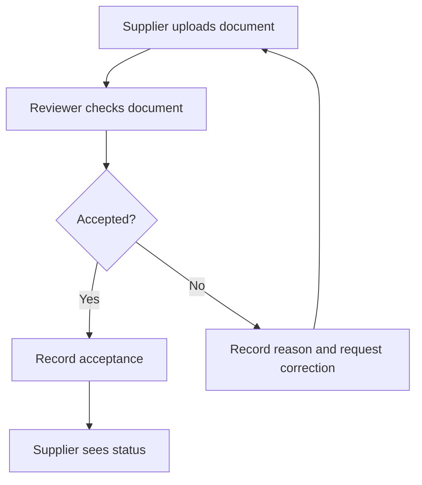

# Process flowchart | P-NNNN / FLOW-NNN

- Workflow and purpose, current or target state, business owner, author, version and date
- Trigger, actors, inputs, outcomes, and scope or exclusions
- Decision conditions, exception paths, ownership changes and open questions
- Requirements, design decision or interface references, and linked QA scenario IDs
- Evidence, reviewer, verification status and exact version described

Illustrative target flow for a supplier portal. Replace it with the verified flow for this project.

