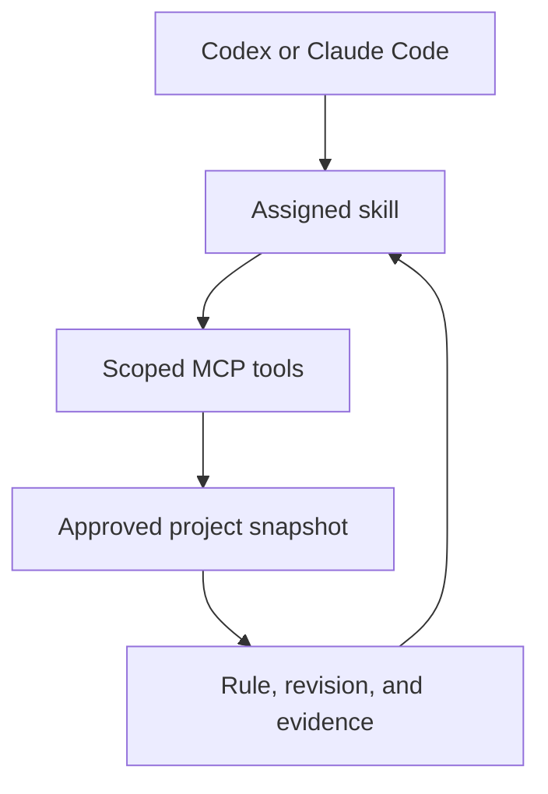

# InfiniteSol memory, MCP and RAG

**Draft for discussion | 20 November 2026.** This proposal records the design and the smallest useful pilot. Pilot build and verification require a scoped Markdown approval. The examples are synthetic.

## How the parts work together

The existing 14 InfiniteSol skills define how the BA, architects, developers, QA and other roles work. Codex and Claude Code are the hosts for the pilot. The Model Context Protocol (MCP) gives them a standard interface to retrieve records. Project Markdown holds the approved decisions and rules. Git can identify the exact recorded revision. The project document register and dated approval determine which revision controls the work.

An MCP connection can make other capabilities available. Keep each connection scoped to its purpose. The memory connection exposes an exact rule lookup and a read-only search for retrieval-augmented generation (RAG). Keep connector actions, access to live business systems and changes to operational data under their own approved scopes.

NimbusFlow's application enforces released rules using its validated runtime configuration or code. A business transaction records the applicable released rule version where the project needs to explain the result later. Agents use the knowledge record for design, implementation and verification. An approved design rule may precede deployment. Show its deployment status separately and use observed release evidence to answer what Production actually runs.

## What memory contains

| Scope | Records | Owner and authority |
|---|---|---|
| Company | CEO preferences, shared policies, workflow gates, proven team practices | PM maintains the register. The applicable company owner approves policies. |
| Product and project | Platform invariants, shared business defaults, interfaces, architecture decisions, and operating procedures | BA and relevant specialists draft. Project and business decision owners approve within their recorded authority. |
| Tenant | Explicit overrides and exceptions, approval thresholds, workflow differences and playbooks | Tenant business owner confirms the rule. PM routes approval under the governing project authority. |
| Delivery and operations | Test evidence, actual deployments, rollback checks, incidents and lessons | Evidence owner records the actual outcome. PM routes any proposed rule or process change separately. |

Shared product rules that support an override state the allowed boundary. Platform invariants such as tenant isolation apply across all tenants. Capture proposed changes as drafts and retain superseded records for authorized historical lookup. The first pilot reads current approved records only.

## Initial read-only MCP tool

Proposed tool name `resolve_business_rule`. The model supplies a stable `rule_id`; reject extra arguments that claim identity or scope. The operator binds each local instance to one approved project, tenant and actor or role grant through protected launch configuration. Reject a missing or ambiguous grant before startup. Keep filesystem access read-only and limited to the bound, allowlisted synthetic snapshot. Keep other tool paths and any broader filesystem access subject to separate controls at the host.

Return the effective rule text, rule ID, owner, project and permitted tenant scope, shared or tenant origin, exact source path and revision, effective date, approval reference and applicable verification links. Pin one versioned snapshot and one evaluation time for the full lookup. Match digests to the allowlisted source and dated approval record, including approver and allowed scope. Use explicit effective timestamps with offsets, with the start inclusive and end exclusive when an end exists. Publish each snapshot as a unit. Reject contradictory overlapping authority and keep drafts out of the accessible snapshot. Log request ID, bound scope, rule ID, result and source revision where available. Keep retrieved document text and secrets out of the audit log.

| Lookup condition | Result |
|---|---|
| Caller is outside the role, project or tenant scope | Return `DENIED` before accessing rule records. Return no details about restricted records. |
| A valid, active tenant override exists and the shared rule permits it | Return that override with its scope, revision and evidence. |
| The approved records confirm that there is no applicable active override | Return the current approved shared rule. Return `NOT_FOUND` if the authorized snapshot confirms there is no rule at either level. |
| Applicable records conflict, a tenant attempts to override a core rule, or a current rule's required approval is invalid | Return `BLOCKED` and route the finding to the appropriate owner. The shared value cannot stand in for unresolved evidence. |
| The snapshot is unavailable or its integrity cannot be verified | Return `UNAVAILABLE`. A previously cached success cannot substitute for current evidence. |

Document and note text may contain instructions as ordinary content. Return bounded text as data and leave external references unfetched. Authority comes from the assignment and the verified decision record. Keep secrets, raw customer records and unrelated project content out of the initial memory dataset. Use synthetic records for both model clients. A local transport keeps the server connection on the machine. The host's model request determines where retrieved context is processed.

## RAG for questions that need context

Retrieval-augmented generation finds relevant source material first, then gives it to the model as context for an answer. The proposed MCP tool `search_project_knowledge` accepts a plain-language query. MCP carries the request and returns the evidence. The host uses that evidence to draft a response.

1. Prepare a searchable copy of authorized Markdown sections from one published snapshot. Keep each section linked to its record ID, exact revision, source path and heading, scope and approval or evidence status. Rebuild the search index from that snapshot when approved records change.
2. Search only the records available within the bound project, role and tenant. Start with keywords and business synonyms such as “POD” and “proof of delivery.” Evaluate search using known questions and expected source revisions. Consider semantic search if the keyword baseline misses useful records when people phrase the same question differently.
3. Return a small set of relevant excerpts and citations from the pinned snapshot. The model ties each material claim to the excerpt that supports it. Insufficient evidence stays unverified. If the source is stale or unavailable, apply the same blocker behavior as the exact lookup.
4. Use `resolve_business_rule` to confirm which rule governs an action. A relevant document can explain the rule or its rationale. The exact lookup applies effective dates, approval and tenant precedence.

For example, when the BA asks “Why can Tenant A invoice early, and what should QA verify?”, search can find the approved decision and QA scenario by meaning or wording. The exact lookup confirms whether the exception is currently effective. The model can then cite the permitted workflow and its checks. If the sources explain the exception but give no business rationale, report that the rationale is unverified.

## Example for NimbusFlow

Use rule `INVOICE.POD_REQUIRED` with a synthetic shared rule requiring proof of delivery before invoicing. Synthetic Tenant A has an approved exception requiring supervisor approval and an audit reason. Synthetic Tenant B has no applicable override and receives the shared rule. Both inherit the platform access invariant.

| Role | What the lookup supports |
|---|---|
| Business Analyst | Identifies the exact rule and its exception when drafting the story. Records the rule revisions in the acceptance criteria. |
| Developer | Implements the approved behavior and associates its evidence with the story and candidate. |
| QA | Verifies Tenant A's exception and Tenant B's default, plus denied access and failure handling. |
| Project Manager | Routes a changed threshold or exception as a draft. A new approved version becomes visible via the published snapshot. |

This example can be reused to classify actual LiGo and Mar-Nins rules after the business owner and BA verify the governing evidence.

## Proposed approval scope for the pilot

The proposed pilot uses a read-only local MCP server over stdio, an approved synthetic snapshot for two tenants held in separately scoped sessions, and no new cash spend. Stage the work by verifying exact rule lookup first, then comparing RAG retrieval against known questions on the same snapshot. Use existing local tools and assess any open-source dependency and licence before implementation. Keep the pilot in its own project folder. The PM would record the exact approved revision, activities, allowed paths, role assignments and end of the test window before dispatch.

| Acceptance case | Required evidence |
|---|---|
| Exact lookup | Codex and Claude Code each retrieve an identical scope, rule ID, effective revision, approval and evidence for the same authorized fixture. |
| Tenant A and Tenant B | Tenant A receives the approved override. Tenant B receives the shared default only when the source confirms the absence of a currently applicable override. |
| Access boundary | Wrong role, tenant or project, claimed identity fields and unknown caller scope are denied. Missing or ambiguous launch grants refuse startup. Response and audit handling respect the boundary. |
| Authority and integrity | Conflicting current rules, missing or expired approval, forbidden override, draft content, changed content at the expected revision and unavailable source return the documented outcomes, including after a prior valid lookup. |
| Effective dates and updates | Future rules become active at the declared time and zone. A lookup during an atomic publish uses one complete snapshot. Superseded results are excluded from subsequent current lookups. |
| Read-only behavior | Calling or interacting with the lookup cannot change source files, approval records or live configuration. Document content does not trigger a different tool action. |
| RAG retrieval | Plain-language questions retrieve the expected current decisions or verification evidence, including when the query uses a known synonym. Search results and counts disclose no records outside the granted scope. |
| RAG answer quality | Each material claim cites a supporting excerpt and revision. A question with no supporting evidence stays unanswered. Similarity or wording does not decide the effective tenant rule. |

The Solution Architect owns the design and MCP boundary, the BA owns the rule model, the Security Architect reviews scope enforcement, and QA independently verifies both client runs. The PM records approval and links the exact evidence.

A separate Claude Code review challenged the original MCP proposal on snapshot consistency, approval provenance, effective dates and the boundary between approved rules and deployed behavior. The design incorporates those findings. MCP integration and RAG are both at draft stage.

Protocol references: [MCP architecture](https://modelcontextprotocol.io/docs/learn/architecture), [tools](https://modelcontextprotocol.io/specification/latest/server/tools), [resources](https://modelcontextprotocol.io/specification/latest/server/resources), and [transports](https://modelcontextprotocol.io/specification/latest/basic/transports).
